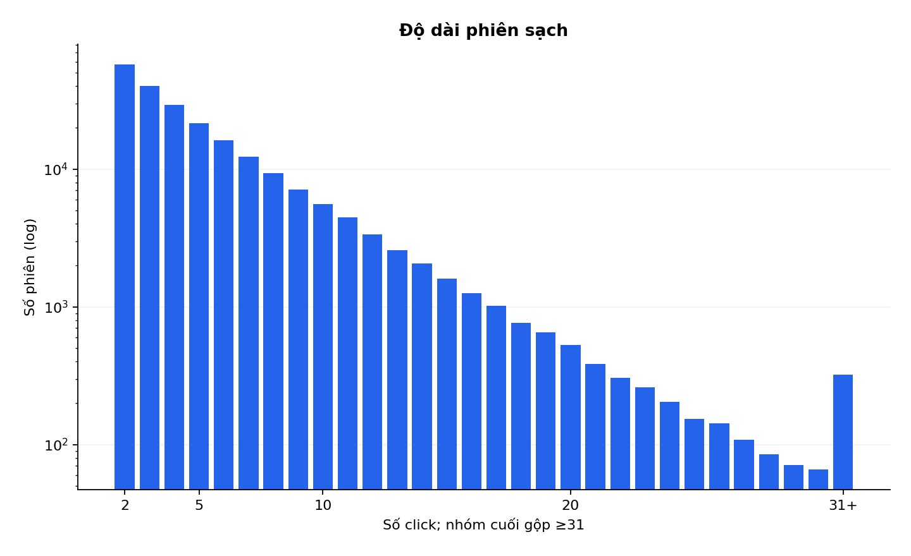
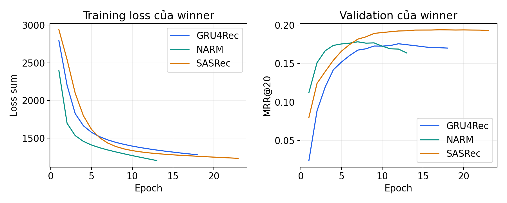
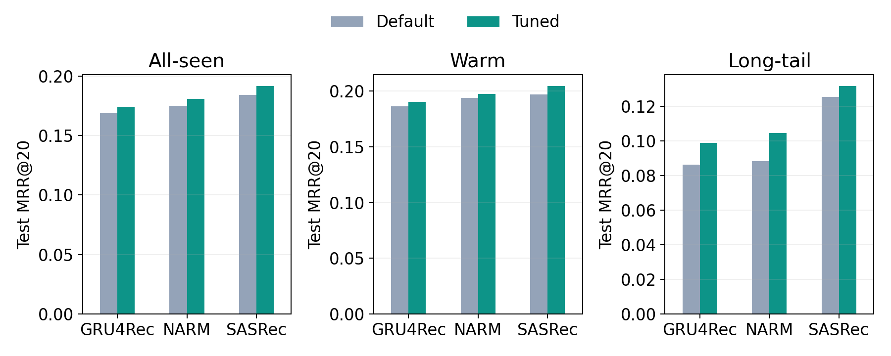
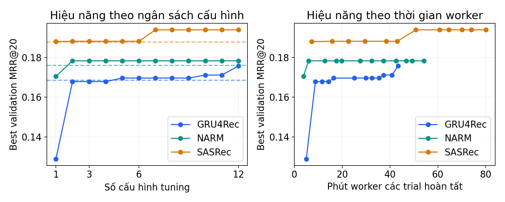

# BTL-T10 | Đánh giá tác động của tuning trong gợi ý theo phiên

Thực hiện: Nguyễn Tuấn Anh; Mai Hoàng Anh

ĐÃ HOÀN TẤT 36 CẤU HÌNH VÀ TEST WINNER

Báo cáo thực nghiệm trên Diginetica với GRU4Rec, NARM và SASRec. So sánh cấu hình tham chiếu của RecBole 1.2.1 với random search 12 cấu hình riêng biệt cho mỗi mô hình. Cùng dữ liệu, seed huấn luyện, cách chọn checkpoint và cách xếp hạng được dùng xuyên suốt.

Mục tiêu là đo ảnh hưởng của siêu tham số đến chất lượng và thứ hạng mô hình. Nghiên cứu không đề xuất kiến trúc mới. Ba câu hỏi: (1) tuning cải thiện bao nhiêu so với mặc định; (2) thứ hạng mô hình có đổi không; (3) mức tăng thay đổi thế nào khi ngân sách tăng từ 1 lên 3, 6 và 12 cấu hình?

Kết quả chính: thay đổi MRR@20 test tương đối sau tuning là GRU4Rec +3.35%; NARM +3.38%; SASRec +3.99%. Thứ hạng và mức tăng theo ngân sách được phân tích riêng ở phần 8-9.

Đơn vị dự đoán là một cặp prefix/next-item. Tập test có 66,305 cặp hợp lệ; tập ứng viên có 36,244 item đã xuất hiện trong train. Điểm đánh giá nằm trong [0,1].

Sản phẩm kèm theo gồm một notebook chứa toàn bộ mã nguồn, các search space và manifest đã đóng băng, bảng điểm từng cấu hình, mô hình được chọn, biểu đồ, tài liệu tham khảo và slide. Báo cáo được tạo bằng mã từ các tệp kết quả, không nhập điểm thủ công.

Các kết luận chỉ áp dụng cho tập dữ liệu, cách chia tập, ngân sách và seed trong thí nghiệm này. Việc dùng cùng số cấu hình không đồng nghĩa cùng chi phí tính toán.

| Nội dung | Thiết lập |
| --- | --- |
| Dữ liệu | Diginetica, tương tác item theo phiên |
| Nền tảng | RecBole 1.2.1, PyTorch 2.5.1, Modal H100 80GB |
| Ngân sách | 3 mặc định + 36 tuning; smoke lưu riêng |
| Chọn mô hình | Validation All-seen MRR@20, tie: trial index nhỏ nhất |
| Seed | Train: 42; random search: 2026 + offset mô hình |
| Mốc học phần | Tuần 1 dữ liệu/baseline; tuần 10 kết quả và báo cáo |

# 1. Cơ sở nghiên cứu và công trình liên quan

Ferrari Dacrema và cộng sự [1] cho thấy kết luận về mô hình gợi ý có thể thay đổi khi baseline được cài đặt và tinh chỉnh tốt hơn. BTL vì vậy lưu cấu hình thực tế, dữ liệu đầu vào và ngân sách tìm kiếm thay vì chỉ báo cáo tên mô hình.

Bergstra và Bengio [2] đề xuất random search như một baseline thực dụng cho tối ưu siêu tham số. Kết quả của bài báo không bảo đảm 12 lượt là đủ; ở đây 12 là ngân sách được chốt trước và được dùng để nghiên cứu đường cong hiệu năng.

Benchmark của Ludewig và cộng sự [3] cho thấy các phương pháp láng giềng có thể cạnh tranh tốt trong gợi ý theo phiên. Ngân sách tuning của mọi mô hình trong bài đó không hoàn toàn giống nhau. BTL giới hạn trong ba mô hình được giao và so sánh cùng số cấu hình.

GRU4Rec [4] dùng mạng hồi quy để biểu diễn lịch sử phiên; NARM [5] kết hợp biểu diễn toàn cục với attention cho ý định hiện tại; SASRec [6] dùng self-attention nhân quả. RecBole [7] cung cấp triển khai chung giúp kiểm soát khác biệt về thư viện.

Các con số công bố dưới đây chỉ mô tả công trình liên quan. Chúng không phải kết quả tái lập của BTL. Khác biệt về dữ liệu, loss, split, catalog, tiền xử lý và sampled/full ranking ngăn việc so sánh trực tiếp độ lớn metric.

| Công trình | Kết quả công bố / bài học áp dụng |
| --- | --- |
| GRU4Rec [4] | RSC15, TOP1 với 1.000 hidden: Recall@20 0,6206; MRR@20 0,2693. BTL dùng RecBole CE trên Diginetica. |
| NARM [5] | Diginetica: Recall@20 62,58%; MRR@20 27,35%. Giao thức gốc khác BTL. |
| SASRec [6] | Đánh giá target cùng 100 item âm. BTL xếp hạng trên toàn bộ 36.244 item train. |
| RecBole [7] | Bài framework mô tả 73 mô hình và 28 bộ dữ liệu; không cung cấp một điểm chuẩn áp dụng cho mọi giao thức. |

# 2. Thu thập và làm sạch dữ liệu

Dữ liệu được tải từ mirror RecoHut-Datasets/diginetica với commit cố định 2672053d53bf74e6e8eec77e684e4e7b6bc5da8c. Hai tệp sử dụng là train-item-views.csv và product-categories.csv. URL, kích thước và SHA-256 của từng tệp được lưu trong data_report.json để phát hiện thay đổi đầu vào.

Pipeline kiểm tra cột cần thiết, giá trị rỗng/không hợp lệ và bản ghi trùng hoàn toàn. Phiên có nhiều ngày bị loại để bảo đảm quy tắc chia theo ngày rõ ràng. Sắp xếp sự kiện theo thời gian trong phiên, giữ thứ tự ổn định khi bằng thời gian và loại phiên ngắn hơn hai sự kiện.

Từ 1,235,380 dòng của 310,324 phiên, loại 260 phiên nhiều ngày và 90,694 phiên ngắn. Không phát hiện dòng không hợp lệ hay trùng hoàn toàn trong lần chạy này. Còn 1,142,593 sự kiện thuộc 219,370 phiên.

Trực quan hóa trước chia tập gồm số lượng loại bỏ, số phiên theo ngày, độ dài phiên, độ phổ biến item và category. Các thống kê này phục vụ mô tả dữ liệu; vocabulary, ngưỡng tần suất và nhãn Warm/Long-tail chỉ được ước lượng từ train.

Category được dùng để kiểm tra độ phủ và mô tả dữ liệu, không đưa vào đầu vào ba mô hình ID-only. Vì vậy báo cáo không suy diễn khả năng cold-start theo nội dung từ độ phủ category.

# 3. Chia tập theo thời gian và kiểm soát rò rỉ

Chia các phiên theo ngày, xấp xỉ 80/10/10 theo số phiên đã làm sạch. Toàn bộ sự kiện của cùng một phiên thuộc một tập. Chia ngày trước khi áp dụng train-core và trước khi mở rộng prefix giúp ngăn các cặp cùng phiên xuất hiện ở cả train lẫn test.

Chỉ trên train, lặp lọc item có dưới 5 tương tác và phiên có dưới 2 sự kiện tới khi ổn định. Vocabulary và ánh xạ ID được xây từ train-core; PAD có ID 0. Sau core còn 774.441 sự kiện, 161.141 phiên và 36.244 item. Các tệp atomic được dùng trực tiếp qua benchmark_filename; RecBole không chia ngẫu nhiên lại.

Mốc tham khảo trong mục 1.6 đề bài là 204.771 phiên và 43.097 item sau tiền xử lý chuẩn. Số ở BTL khác vì chia theo ngày trước rồi fit core/vocabulary chỉ trên train, cùng quy tắc loại phiên nhiều ngày. Không coi hai số của train-core là tái lập nguyên vẹn mốc toàn bộ dữ liệu.

Với mỗi vị trí từ sự kiện thứ hai, lấy các item trước đó làm prefix và item tại vị trí hiện tại làm target. Prefix dài hơn 50 được giữ 50 item gần nhất. Trong valid/test, loại target ngoài vocabulary, loại item OOV khỏi prefix và bỏ mẫu nếu prefix đã biết bị rỗng. Target không được đưa vào prefix.

Valid bỏ 20.897 target OOV và 1.878 prefix rỗng; test bỏ 21.754 target OOV và 2.200 prefix rỗng. Do đó kết quả là chất lượng trên các mẫu target đã biết đủ điều kiện, không đại diện cho mọi item mới ngoài vocabulary.

Warm: target có tần suất >10 trong tương tác train-core trước prefix augmentation. Long-tail: target có tần suất từ 1 đến 10 trong cùng thống kê; với core hiện tại tần suất thực tế tối thiểu là 5. Test có 54.466 mẫu Warm và 11.839 mẫu Long-tail. All-seen là hợp của hai nhóm, không đồng nhất với Warm.

Phạm vi T10 mục 9 là Diginetica (warm); mục 17 chỉ mở rộng cold-start sau mốc cuối. Thí nghiệm chính không tạo I_cold 20%. Cold: N/A cho ba mô hình ID-only; target OOV bị loại không được gọi là tập I_cold 20% của giao thức mở rộng.

| Tập | Ngày đầu | Ngày cuối | Phiên trước core | Cặp hợp lệ |
| --- | --- | --- | --- | --- |
| train | 2016-01-01 | 2016-05-12 | 175,802 | 613,300 |
| valid | 2016-05-13 | 2016-05-23 | 21,766 | 65,924 |
| test | 2016-05-24 | 2016-06-01 | 21,802 | 66,305 |

| Kiểm tra | Bằng chứng |
| --- | --- |
| Cùng dữ liệu cho mọi model | b93fbf33b89e2bc78ee63d87ba2554ec... |
| Category coverage | 100%; chỉ dùng mô tả |
| Tỷ lệ phiên trước core | Train 80,14%; valid 9,92%; test 9,94% |

# 4. Mô hình tham chiếu và không gian tìm kiếm

Mặc định trong báo cáo là các siêu tham số kiến trúc và learning rate tham chiếu từ RecBole 1.2.1 đã lưu trong baseline_defaults.json. Các điều kiện thí nghiệm chung được đặt rõ: CE loss, Adam, batch train 2.048, batch eval 128, seed 42, tối đa 30 epoch và stopping_step=5. Đây không phải tuyên bố dùng mọi mặc định gốc của thư viện; chẳng hạn epochs mặc định của RecBole là 300.

GRU4Rec biểu diễn prefix bằng trạng thái ẩn của GRU. NARM học attention trên các trạng thái để kết hợp sở thích cục bộ và toàn cục. SASRec dùng attention nhân quả và embedding vị trí, không nhìn sự kiện tương lai. Không sử dụng user embedding hay thông tin nội dung ngoài ID item.

Mỗi mô hình có 54 tổ hợp trong không gian hữu hạn; loại tổ hợp trùng cấu hình tham chiếu còn 53. Lấy ngẫu nhiên không hoàn lại 12 tổ hợp, seed 2026 + offset 0/1/2 cho GRU4Rec/NARM/SASRec. Manifest 36 cấu hình và checksum được đóng băng trước khi chạy; không chọn lại theo test.

Các tham số không có trong bảng được giữ như baseline. embedding_size=64 của GRU4Rec/NARM; SASRec giữ n_heads=2, inner_size=256. Dropout của attention SASRec được ghép bằng hidden_dropout_prob qua adapter materialize, không lấy mẫu độc lập.

Baseline cụ thể: GRU4Rec hidden=128, 1 lớp, dropout=0,3; NARM hidden=128, 1 lớp, dropout=[0,25;0,5]; SASRec hidden=64, 2 lớp, dropout hidden/attention=0,5. Cả ba có learning_rate=0,001. Các giá trị này được đối chiếu resolved_config trước khi chạy search.

| Model | Siêu tham số | Giá trị thử |
| --- | --- | --- |
| Chung | learning_rate | 0,0003; 0,001; 0,003 |
| GRU4Rec | hidden_size / num_layers | 64, 128, 256 / 1, 2 |
| GRU4Rec | dropout_prob | 0,1; 0,3; 0,5 |
| NARM | hidden_size / n_layers | 64, 128, 256 / 1, 2 |
| NARM | dropout_probs | [0,1;0,1]; [0,25;0,5]; [0,5;0,5] |
| SASRec | hidden_size / n_layers | 32, 64, 128 / 1, 2 |
| SASRec | hidden & attention dropout | 0,1; 0,3; 0,5 (cùng giá trị) |

# 5. Huấn luyện, chọn checkpoint và định nghĩa metric

Mỗi trial dùng cùng seed 42 và split. Lưu checkpoint có validation All-seen MRR@20 tốt nhất. Đánh giá validation mỗi epoch; RecBole dừng khi bộ đếm không cải thiện >5, bằng điểm tốt nhất sẽ đặt lại bộ đếm. Tối đa 30 epoch được dùng như giới hạn ngân sách chung, không phải bảo đảm mọi mô hình hội tụ.

Sau khi đủ 12 trial/model, chọn trial có best validation MRR@20 lớn nhất; hòa chọn trial_index nhỏ nhất. Nạp lại checkpoint và kiểm tra ánh xạ item, số mẫu cùng fingerprint trước khi chấm test. Không retrain gộp train+valid vì sẽ thay đổi điều kiện so sánh với baseline.

Với một target mỗi prefix và hạng r bắt đầu từ 1: HR@K = mean(1[r<=K]); MRR@20 = mean(1[r<=20]/r); NDCG@20 = mean(1[r<=20]/log2(r+1)). IDCG của mỗi mẫu bằng 1. Trong giao thức single-target này, HR@K và Recall@K có cùng giá trị.

Chấm trên toàn bộ 36.244 item train, loại PAD và cho phép gợi ý lặp lại item trong lịch sử. Khi bằng điểm, ưu tiên internal item ID nhỏ hơn để kết quả có quy tắc rõ ràng. Báo cáo HR@10, HR@20, MRR@20 và NDCG@20 trên All-seen, Warm và Long-tail.

Điểm test baseline được lưu ở tuần 1; điểm test của các trial tuning không được tính trong search. Kết quả từng trial có test=null, test_evaluated=false. Ba winner chỉ được chấm sau khi kết thúc tìm kiếm. Mã kiểm tra cuối từ chối xuất báo cáo hoàn chỉnh nếu vi phạm điều kiện này.

Đường loss dưới đây là tổng loss của các batch trong từng epoch, không phải loss trung bình trên mỗi mẫu. Learning curve dùng để kiểm tra diễn biến huấn luyện; kết luận chất lượng dựa trên checkpoint được chọn bằng validation.

# 6. Kết quả từng cấu hình đã chạy

Bảng ghi điểm validation tốt nhất của từng trial. Danh sách overrides đầy đủ, thời gian worker, checkpoint và số epoch nằm trong all_trials.csv và trial_manifest.csv. Smoke không xuất hiện ở bảng này. Không dùng điểm test để xếp thứ tự cấu hình.

| Trial | Valid MRR20 | Best ep. | Epoch | Train+val (s) |
| --- | --- | --- | --- | --- |
| GRU4Rec-t01 | 0.12884 | 30 | 30 | 280.3 |
| GRU4Rec-t02 | 0.16786 | 28 | 30 | 213.7 |
| GRU4Rec-t03 | 0.16046 | 12 | 18 | 158.3 |
| GRU4Rec-t04 | 0.16658 | 7 | 13 | 144.7 |
| GRU4Rec-t05 | 0.16960 | 7 | 13 | 111.7 |
| GRU4Rec-t06 | 0.13809 | 30 | 30 | 500.8 |
| GRU4Rec-t07 | 0.12460 | 30 | 30 | 267.6 |
| GRU4Rec-t08 | 0.16585 | 9 | 15 | 138.3 |
| GRU4Rec-t09 | 0.16911 | 12 | 18 | 158.5 |
| GRU4Rec-t10 | 0.17112 | 9 | 15 | 100.4 |
| GRU4Rec-t11 | 0.15769 | 15 | 21 | 192.7 |
| GRU4Rec-t12 | 0.17574 | 12 | 18 | 141.0 |
| NARM-t01 | 0.17046 | 17 | 23 | 215.5 |
| NARM-t02 | 0.17828 | 7 | 13 | 113.7 |
| NARM-t03 | 0.12662 | 30 | 30 | 393.0 |
| NARM-t04 | 0.16708 | 21 | 27 | 268.2 |
| NARM-t05 | 0.17543 | 6 | 12 | 116.3 |
| NARM-t06 | 0.15959 | 30 | 30 | 447.7 |
| NARM-t07 | 0.17333 | 28 | 30 | 278.9 |
| NARM-t08 | 0.16619 | 28 | 30 | 279.3 |
| NARM-t09 | 0.14707 | 30 | 30 | 298.8 |
| NARM-t10 | 0.17261 | 22 | 28 | 246.4 |
| NARM-t11 | 0.17171 | 7 | 13 | 129.1 |
| NARM-t12 | 0.16299 | 28 | 30 | 287.5 |
| SASRec-t01 | 0.18795 | 21 | 27 | 426.0 |
| SASRec-t02 | 0.18813 | 30 | 30 | 497.4 |
| SASRec-t03 | 0.18641 | 15 | 21 | 389.8 |
| SASRec-t04 | 0.17854 | 30 | 30 | 405.5 |
| SASRec-t05 | 0.17620 | 30 | 30 | 519.8 |
| SASRec-t06 | 0.18530 | 7 | 13 | 259.4 |
| SASRec-t07 | 0.19387 | 17 | 23 | 455.1 |
| SASRec-t08 | 0.19232 | 30 | 30 | 574.9 |
| SASRec-t09 | 0.18632 | 14 | 20 | 216.4 |
| SASRec-t10 | 0.18813 | 30 | 30 | 317.1 |
| SASRec-t11 | 0.19371 | 11 | 17 | 217.6 |
| SASRec-t12 | 0.18730 | 28 | 30 | 353.7 |

# 7. Mặc định so với tuning trên toàn bộ mẫu đủ điều kiện

Mọi hàng dùng cùng 66.305 mẫu test và cùng catalog. Default là ba kết quả tuần 1 được giữ nguyên; Tuned là checkpoint thắng theo validation sau đúng 12 cấu hình/model, không chọn theo test.

GRU4Rec: MRR@20 test từ 0.16852 đến 0.17417, chênh +0.00565 (+3.35%). Cấu hình chọn: {"learning_rate": 0.003, "hidden_size": 64, "num_layers": 1, "dropout_prob": 0.3}.

NARM: MRR@20 test từ 0.17483 đến 0.18074, chênh +0.00590 (+3.38%). Cấu hình chọn: {"learning_rate": 0.001, "hidden_size": 256, "n_layers": 1, "dropout_probs": [0.1, 0.1]}.

SASRec: MRR@20 test từ 0.18416 đến 0.19151, chênh +0.00735 (+3.99%). Cấu hình chọn: {"learning_rate": 0.0003, "hidden_size": 128, "n_layers": 2, "hidden_dropout_prob": 0.3, "attn_dropout_prob": 0.3}.

Có đánh đổi giữa các metric: NARM HR@20 từ 0.52426 xuống 0.52317. Winner được chọn theo validation MRR@20, nên không bảo đảm mọi metric test cùng tăng.

Δ tuyệt đối = tuned - default. Tăng tương đối = (tuned - default)/default x 100%. Chênh lệch trên thang [0,1] và phần trăm tương đối là hai đại lượng khác nhau. Một winner validation có thể kém default trên test; kết quả như vậy vẫn được giữ và báo cáo.

Chỉ có một seed huấn luyện. Các chênh lệch ở đây là quan sát thực nghiệm, không được diễn giải là khác biệt có ý nghĩa thống kê hoặc bảo đảm cho một lần chạy khác.

| Mô hình | Thiết lập | HR@10 | HR@20 | MRR@20 | NDCG@20 |
| --- | --- | --- | --- | --- | --- |
| GRU4Rec | Default | 0.37193 | 0.50744 | 0.16852 | 0.24309 |
| GRU4Rec | Tuned | 0.38192 | 0.51488 | 0.17417 | 0.24930 |
| NARM | Default | 0.38730 | 0.52426 | 0.17483 | 0.25186 |
| NARM | Tuned | 0.38937 | 0.52317 | 0.18074 | 0.25632 |
| SASRec | Default | 0.39459 | 0.53525 | 0.18416 | 0.26146 |
| SASRec | Tuned | 0.41602 | 0.55530 | 0.19151 | 0.27192 |

| Model | Δ MRR@20 | Tăng tương đối | Winner theo validation |
| --- | --- | --- | --- |
| GRU4Rec | +0.00565 | +3.35% | GRU4Rec-t12 |
| NARM | +0.00590 | +3.38% | NARM-t02 |
| SASRec | +0.00735 | +3.99% | SASRec-t07 |

# 8. Warm, Long-tail và sự thay đổi thứ hạng

Phân nhóm theo tần suất target trong train, không theo độ dài prefix hay độ phổ biến trong test. Bảng và biểu đồ cho thấy tuning có tác động đồng đều lên item phổ biến và ít phổ biến hay không. Không chọn một winner riêng cho mỗi nhóm sau khi xem test.

All-seen: thứ hạng default SASRec > NARM > GRU4Rec; sau tuning SASRec > NARM > GRU4Rec.

Warm: thứ hạng default SASRec > NARM > GRU4Rec; sau tuning SASRec > NARM > GRU4Rec.

Long-tail: thứ hạng default SASRec > NARM > GRU4Rec; sau tuning SASRec > NARM > GRU4Rec.

All-seen là trung bình theo từng mẫu nên chịu ảnh hưởng lớn hơn từ Warm, nhóm chiếm khoảng 82,15% test. Không lấy trung bình đơn giản của hai điểm nhóm để suy ra All-seen. Các metric đầy đủ cho từng nhóm nằm trong default_vs_tuned.csv.

| Nhóm | Model | Default MRR20 | Tuned MRR20 | Δ |
| --- | --- | --- | --- | --- |
| Warm | GRU4Rec | 0.18639 | 0.19053 | +0.00414 |
| Warm | NARM | 0.19364 | 0.19729 | +0.00365 |
| Warm | SASRec | 0.19694 | 0.20453 | +0.00759 |
| Long-tail | GRU4Rec | 0.08629 | 0.09889 | +0.01260 |
| Long-tail | NARM | 0.08831 | 0.10458 | +0.01626 |
| Long-tail | SASRec | 0.12540 | 0.13165 | +0.00625 |

# 9. Hiệu năng theo ngân sách và dấu hiệu bão hòa

Đường cong lấy max validation trong k cấu hình đầu đúng thứ tự manifest. Baseline không được tính trong k và được vẽ nét đứt. Trục thời gian cộng thời gian worker của các trial hoàn tất trong từng model; không bao gồm thời gian chờ app, CPU controller và smoke, vì vậy không phải hóa đơn Modal.

GRU4Rec: tăng validation từ 6 lên 12 là +0.00614, đạt best ở trial 12; chưa có bằng chứng bão hòa trong ngân sách này.

NARM: tăng validation từ 6 lên 12 là +0.00000, đạt best ở trial 2; 10 trial sau đó không vượt điểm này trong thứ tự đã chốt.

SASRec: tăng validation từ 6 lên 12 là +0.00574, đạt best ở trial 7; 5 trial sau đó không vượt điểm này trong thứ tự đã chốt.

* k đạt 99% là vị trí đầu tiên có best-so-far >= 99% điểm tốt nhất sau 12 trial, được tính sau khi biết toàn bộ kết quả. Đây là chỉ báo mô tả mức lợi ích giảm dần trên một thứ tự search đã chốt, không phải tiêu chuẩn dừng online hay bằng chứng hội tụ toàn bộ không gian.

Để đánh giá độ ổn định của bão hòa cần lặp nhiều seed/thứ tự search hoặc ngân sách lớn hơn. Báo cáo không suy rộng điểm ở k=12 thành mức tối ưu toàn cục.

| Model | k=1 | k=3 | k=6 | k=12 | k đạt 99%* |
| --- | --- | --- | --- | --- | --- |
| GRU4Rec | 0.12884 | 0.16786 | 0.16960 | 0.17574 | 12 |
| NARM | 0.17046 | 0.17828 | 0.17828 | 0.17828 | 2 |
| SASRec | 0.18795 | 0.18813 | 0.18813 | 0.19387 | 7 |

# 10. Khả năng tái lập, chi phí và giới hạn

Notebook duy nhất chứa mã tải dữ liệu, EDA, split, train, metric, search, kiểm tra kết quả, tạo biểu đồ và tài liệu. Các module trong .btl_t10_runtime được xuất tự động từ chính các cell; người dùng không phải ghép code từ nhiều tệp. Chạy lại nhận diện trial đã xong qua fingerprint và overrides, giữ checkpoint cũ và lưu riêng từng attempt lỗi.

GPU H100 80GB được gọi trên Modal; dữ liệu và báo cáo xử lý trên laptop/CPU. Cloud image ghim Python 3.10, torch 2.5.1+cu124, numpy 1.23.5, pandas 1.5.3, scipy 1.10.1 và recbole 1.2.1. Môi trường local xuất requirements riêng để tránh nhầm với môi trường GPU.

Ngưỡng 5 giờ trong điều phối là giới hạn thời gian lời gọi GPU tích lũy, không phải giới hạn tiền trên tài khoản. Không suy ra chi phí hóa đơn từ thời gian train thuần; cần xem usage thực tế của Modal. So sánh công bằng ở đây là số cấu hình bằng nhau, chưa chuẩn hóa FLOPs hoặc thời gian.

Có một lần điều phối bị kẹt sau khi NARM-t09 đã lưu xong. Job được khôi phục từ kết quả và checkpoint, không train lại trial đã hoàn tất và không thay manifest. Khoảng chờ điều phối không được dùng làm thời gian GPU trong đường cong; nhật ký khôi phục nằm trong execution_events.json.

Giới hạn: một dataset, một train seed, 12 cấu hình/model, tối đa 30 epoch. Split và OOV policy có thể làm thay đổi chất lượng quan sát. Các item mới bị loại khỏi target đánh giá; không có kết luận ID cold-start. Không đo độ trễ phục vụ production, không kiểm định thống kê và không tuyên bố tái lập nguyên vẹn bài gốc.

Bước phát triển phù hợp sau phạm vi này: lặp train/search nhiều seed, báo cáo khoảng biến thiên; mở rộng dataset và so sánh theo thời gian/FLOPs; kiểm tra độ nhạy split và ngưỡng train-core. Các mở rộng này không được đưa vào bảng chính như thể đã chạy.

| Model | Default train+val (phút) | 12 trial worker (phút) |
| --- | --- | --- |
| GRU4Rec | 3.59 | 43.39 |
| NARM | 2.85 | 54.24 |
| SASRec | 8.17 | 80.16 |

| Mốc | Sản phẩm |
| --- | --- |
| Tuần 1 | Dữ liệu, EDA, split, ba baseline |
| Tuần 2-3 | Search space, manifest, kiểm tra code và smoke |
| Tuần 4-6 | 6 cấu hình/model; kết quả validation giữa kỳ |
| Tuần 7-8 | Đủ 12 cấu hình/model; chọn và test winner |
| Tuần 9-10 | Phân tích ngân sách, báo cáo 12 trang, slide và gói nộp |

# 11. Kết luận và tài liệu tham khảo

Bài tập đã xây dựng quy trình thống nhất để tách tác động của tuning khỏi thay đổi dữ liệu, metric và điều kiện chọn mô hình.

GRU4Rec: MRR@20 test từ 0.16852 đến 0.17417, chênh +0.00565 (+3.35%). Cấu hình chọn: {"learning_rate": 0.003, "hidden_size": 64, "num_layers": 1, "dropout_prob": 0.3}.

NARM: MRR@20 test từ 0.17483 đến 0.18074, chênh +0.00590 (+3.38%). Cấu hình chọn: {"learning_rate": 0.001, "hidden_size": 256, "n_layers": 1, "dropout_probs": [0.1, 0.1]}.

SASRec: MRR@20 test từ 0.18416 đến 0.19151, chênh +0.00735 (+3.99%). Cấu hình chọn: {"learning_rate": 0.0003, "hidden_size": 128, "n_layers": 2, "hidden_dropout_prob": 0.3, "attn_dropout_prob": 0.3}.

Theo MRR@20 All-seen, thứ hạng mặc định là SASRec > NARM > GRU4Rec; sau tuning là SASRec > NARM > GRU4Rec.

Mốc k đầu đạt 99% best cuối theo thứ tự search này: GRU4Rec k=12; NARM k=2; SASRec k=7. Đây là mô tả post-hoc, chưa phải bảo đảm hội tụ hay quy tắc dừng online.

Kết quả từ các bài báo giúp thiết kế thí nghiệm và giải thích giới hạn so sánh; không được dùng để thay thế kết quả chạy thực tế. Mọi con số trong phần thực nghiệm được sinh từ các tệp JSON/CSV và checkpoint kèm theo.

Khuyến nghị: công bố cả default và tuned, cùng ngân sách cấu hình, split và metric; chọn trên validation và lưu toàn bộ cấu hình. Báo cáo MRR cùng HR vì có thể đánh đổi giữa các metric. Với GRU4Rec, thí nghiệm này chưa ủng hộ dừng ở 6 cấu hình vì best xuất hiện ở trial 12; các mốc bão hòa cần kiểm tra thêm qua nhiều seed trước khi dùng làm quy tắc dừng.

[1] M. Ferrari Dacrema, P. Cremonesi, D. Jannach. Are We Really Making Much Progress? A Worrying Analysis of Recent Neural Recommendation Approaches. RecSys, 2019. https://arxiv.org/abs/1907.06902

[2] J. Bergstra, Y. Bengio. Random Search for Hyper-Parameter Optimization. JMLR 13, pp. 281-305, 2012. https://jmlr.org/papers/v13/bergstra12a.html

[3] M. Ludewig, N. Mauro, S. Latifi, D. Jannach. Empirical Analysis of Session-Based Recommendation Algorithms: A Comparison of Neural and Non-Neural Approaches. UMUAI 31, pp. 149-181, 2021. https://doi.org/10.1007/s11257-020-09277-1

[4] B. Hidasi, A. Karatzoglou, L. Baltrunas, D. Tikk. Session-based Recommendations with Recurrent Neural Networks. ICLR, 2016. https://arxiv.org/abs/1511.06939

[5] J. Li, P. Ren, Z. Chen, Z. Ren, T. Lian, J. Ma. Neural Attentive Session-based Recommendation. CIKM, 2017. https://arxiv.org/abs/1711.04725

[6] W.-C. Kang, J. McAuley. Self-Attentive Sequential Recommendation. ICDM, 2018. https://arxiv.org/abs/1808.09781

[7] W. X. Zhao et al.. RecBole: Towards a Unified, Comprehensive and Efficient Framework for Recommendation Algorithms. CIKM, 2021. https://arxiv.org/abs/2011.01731
